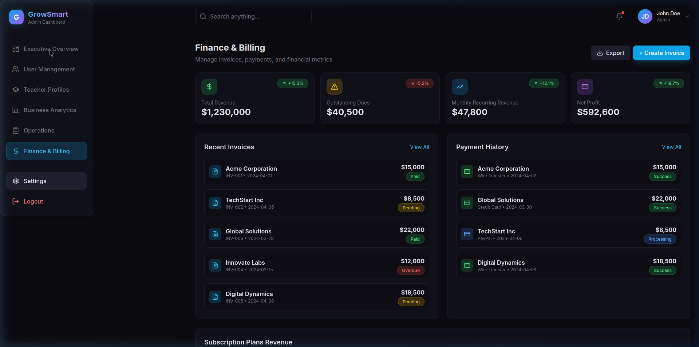
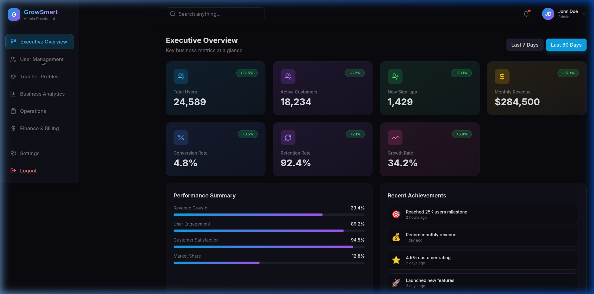
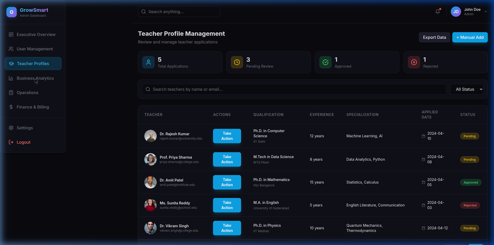
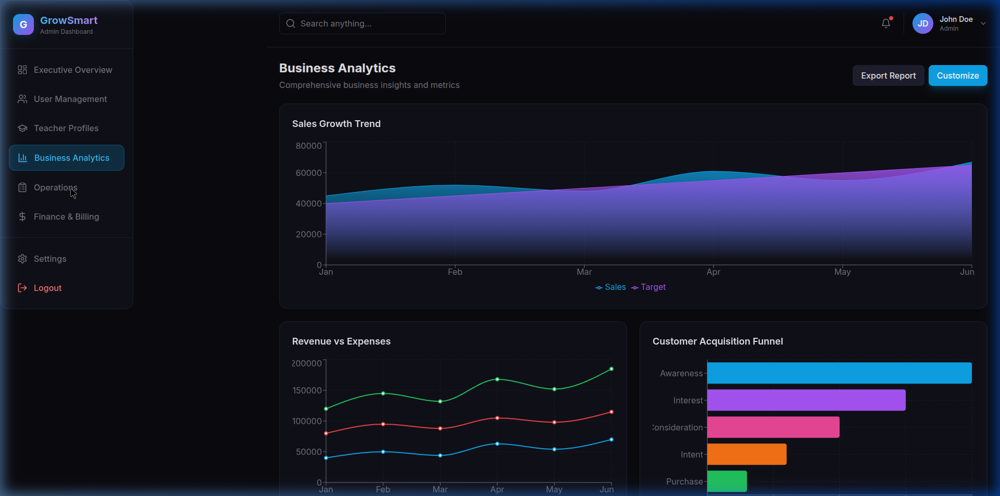
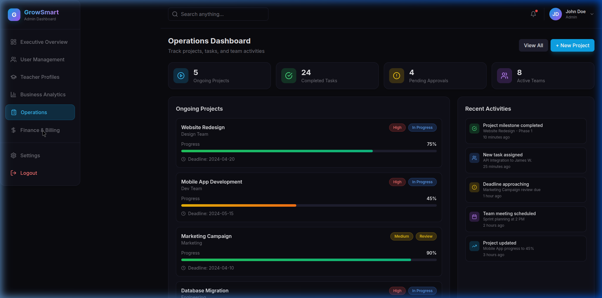

# GrowSmart Admin Dashboard

A modern, premium admin dashboard for business growth, analytics, and user management. Built with React 18, Tailwind CSS, and Recharts for data visualization.

## Dashboard Previews

### Executive Overview


### User Management


### Business Analytics


### Operations


### Finance & Billing


## Features

### Dashboard Sections

- **Executive Overview**: Key business metrics at a glance with elegant metric cards
- **User Management**: Detailed user management with search and filters
- **Business Analytics**: Advanced visual analytics with interactive charts (Indian states data)
- **Operations Dashboard**: Track projects, tasks, and team activities
- **Finance & Billing**: Manage invoices, payments, and financial metrics
- **Notifications Panel**: Real-time alerts, user issues, and pending actions

## Tech Stack

- **React 18**: Modern React with hooks and functional components
- **Tailwind CSS**: Utility-first CSS framework for styling
- **Recharts**: Data visualization library for interactive charts
- **Lucide React**: Beautiful, consistent icons
- **Vite**: Fast build tool and development server
- **PostCSS**: CSS processing with Autoprefixer

## Getting Started

### Prerequisites

- Node.js 16+ installed
- npm or yarn package manager

### Install Dependencies

```bash
npm install
```

### Run Development Server

```bash
npm run dev
```

The dashboard will be available at `http://localhost:3000` (or the next available port if 3000 is in use)

### Build for Production

```bash
npm run build
```

### Preview Production Build

```bash
npm run preview
```

## Design Features

- Modern SaaS-style admin dashboard
- Dark theme with glassmorphism cards
- Clean sidebar navigation with active state indicators
- Smooth transitions and hover animations
- Interactive charts and graphs
- Premium corporate design
- Fully responsive for desktop, tablet, and mobile
- Minimal and elegant typography
- Inspired by Stripe, HubSpot, and Notion admin panels

## Project Structure

```
growsmart-dashboard/
├── src/
│   ├── components/
│   │   ├── Sidebar.jsx              # Main navigation sidebar
│   │   ├── ExecutiveOverview.jsx    # Dashboard metrics and overview
│   │   ├── UserManagement.jsx       # User management system
│   │   ├── BusinessAnalytics.jsx    # Analytics with charts
│   │   ├── OperationsDashboard.jsx  # Operations tracking
│   │   ├── FinanceBilling.jsx       # Finance and billing
│   │   └── NotificationsPanel.jsx   # Notifications and alerts
│   ├── App.jsx                      # Main application component
│   ├── main.jsx                     # Application entry point
│   └── index.css                    # Global styles and Tailwind imports
├── index.html                       # HTML template
├── package.json                     # Dependencies and scripts
├── tailwind.config.js               # Tailwind CSS configuration
├── vite.config.js                   # Vite configuration
└── postcss.config.js                # PostCSS configuration
```

## Customization

### Colors

Colors are defined in `tailwind.config.js` under the `theme.extend.colors` section. You can customize the primary, accent, and dark theme colors to match your brand.

### Components

Each dashboard section is a separate component in `src/components/`. You can modify or extend these components to add new features or change existing functionality.

## Customization

Charts are powered by Recharts. You can customize chart types, data, and styling in each analytics component. The regional data currently shows Indian states (Maharashtra, Tamil Nadu, Karnataka, Uttar Pradesh, Delhi).

## Deployment

### Deploy to Vercel

```bash
npm install -g vercel
vercel
```

### Deploy to Netlify

```bash
npm run build
# Upload the 'dist' folder to Netlify
```

### Deploy to GitHub Pages

```bash
npm run build
# Configure GitHub Pages to serve from the 'dist' folder
```

## Scripts

- `npm run dev` - Start development server
- `npm run build` - Build for production
- `npm run preview` - Preview production build locally

## Browser Support

- Chrome (latest)
- Firefox (latest)
- Safari (latest)
- Edge (latest)

## License

MIT License - feel free to use this project for personal or commercial purposes.

## Support

For issues, questions, or contributions, please open an issue on the GitHub repository.
